<p align="center">
  
</p>

<h1 align="center">Kyllene</h1>

<p align="center">
  <b>The desktop workspace for <a href="https://hermes-agent.nousresearch.com/">Hermes Agent</a>.</b><br>
  Projects, tasklists, Kanban, coding agents and many conversations at once, in one fast native window.
</p>

<p align="center">
  <a href="https://github.com/cpoint-eu/kyllene-releases/releases/latest"></a>
  
  
  
  <a href="https://ko-fi.com/cpointeu"></a>
</p>

<p align="center">
  <a href="https://cpoint-eu.github.io/kyllene/"><b>Website</b></a> ·
  <a href="#get-kyllene"><b>Install</b></a> ·
  <a href="#-let-your-ai-install-it"><b>🤖 Let your AI install it</b></a> ·
  <a href="docs/README.md"><b>Documentation</b></a> ·
  <a href="docs/widgets.md"><b>Build your own widget</b></a> ·
  <a href="https://github.com/cpoint-eu/kyllene-releases/releases"><b>Release notes</b></a> ·
  <a href="https://github.com/cpoint-eu/kyllene-releases/issues/new?template=bug.yml"><b>Report a bug</b></a>
</p>

<p align="center">
  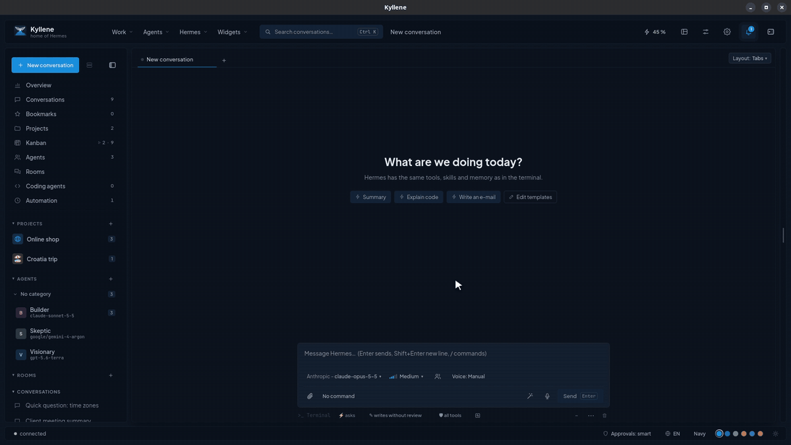
</p>

### ▶ The 3-minute tour

https://github.com/user-attachments/assets/548e8352-62e9-4b43-9666-2d06aa878c99

<sub>All data in the video and the screenshots is made up.</sub>

---

## Why Kyllene

Hermes is a great agent. It remembers, learns new skills and works for you around the clock. But most of the time
you meet it in a terminal or a chat box, one conversation at a time.

Kyllene turns Hermes into a place where your work lives. Every project gets a home with its conversations, files,
tasklists, a Kanban board and git. You can run five conversations side by side, hand a task to an agent and come
back when it is done, see what each day cost, and manage all of Hermes without touching a config file. And when
something is missing, you add it: widgets let you put anything on screen, and Hermes can write them for you.

It is the same Hermes underneath. Kyllene talks to your existing install, so sessions, memory, skills and profiles
are shared: start something in Kyllene and continue it in the terminal, or the other way round. No lock-in, no
account, no cloud of its own.

*Kyllene is the mountain in Arcadia where Hermes was born. Hence the tagline: home of Hermes.*

## Hermes alone vs. Hermes in Kyllene

| | Hermes in a terminal | Hermes in Kyllene |
|---|---|---|
| **Conversations** | One per terminal window | Tabs, a grid or free windows; pop any conversation out into its own window |
| **Answers** | Text and ASCII | Rendered Markdown: tables, Mermaid diagrams, highlighted code, a live panel of every tool call |
| **Questions and approvals** | Type the answer or `y`/`n` | Clickable choices, approval cards, a diff of every file change before it is written |
| **Models** | `/model` and a model name | Search all providers with price, context and benchmark class; compare two models on one prompt |
| **Projects** | A folder you `cd` into | A project home: conversations, files with previews, outputs gallery, git, tasklists, Kanban |
| **Background work** | `hermes kanban` commands | A drag-and-drop board; agents run cards in the background and ping you when they need you |
| **Coding agents** | Separate terminals | Claude Code and Codex inside the app, with the same approval cards |
| **Managing Hermes** | Editing YAML, CLI commands | Skills, MCP servers, plugins, cron, profiles, keys, memory, logs and gateways in one screen |
| **Costs and usage** | Numbers per session | Overview of tokens and costs by model, agent and project; subscription limits with a pace line; a timeline of the whole day |
| **Several computers** | Each one on its own | Projects, tasklists, settings and widgets sync through GitHub or your cloud drive |
| **Your own additions** | Skills and plugins for the agent | Plus widgets for the app: anything you want on screen, written by you or by Hermes itself |

## Features

### Conversations

- Answers stream live with tables, Mermaid diagrams and syntax-highlighted code; copy, save or edit a diagram.
- **Activity panel** shows every tool call as it happens: what ran, how long it took, what it returned.
- The agent asks with **clickable choices**; risky commands wait for your OK; file writes can be reviewed as a diff.
- **Many conversations at once**: tabs, a grid, free windows, or a conversation in its own window.
- **Search everything** with `Ctrl+K`: conversations, projects, files, tasklists and every command.
- **Quick capture**: a global shortcut takes a screenshot, you add a question, the answer appears in a small window.
- Attachments and pasted images, prompt templates, bookmarks, export, `/later` (continue at a set time or when a background job ends).
- A conversation keeps running when you close the app; drafts and attachments survive restarts.

### Models

- One picker for every provider Hermes knows: search, description, price, context window, capabilities.
- Benchmark classes and favourites; switch the model of a running conversation in one click.
- **Compare**: send one prompt to two models side by side and continue with the winner.

### Projects and tasks

- A project = a folder with its conversations, files (with previews), an **outputs gallery** of everything the agents made, and a **git panel** (diff, commit message written by AI, every write confirmed first).
- **Tasklists** in plain Markdown: the agent ticks items off while it works; you edit them like a document.
- **Ask AI on any task**: split it into subtasks, rephrase or estimate; edits land in the file, with Undo.
- **Kanban**: hand cards to agents; they run in the background, ask when they are stuck, and you review the result. Watch any run live in its own window.
- **Focus mode** hides everything outside the current project and mutes its notifications.

### Agents

- Hermes profiles as **agents** with their own model, memory and personality; group them in categories and rooms.
- **Claude Code and Codex** run inside the app with approvals, slash commands and their history.
- Delegated sub-agents and background processes are visible in the conversation while they run.

### Widgets: make it do what you need

Kyllene is meant to be shaped to your work, not the other way round. Widgets are small cards and windows you put
wherever you want: the side panel, the Overview, the top or bottom bar, or the main area.

- **Ready to use**: Claude Code, Codex and OpenRouter limits with a pace line (will it last until the reset?),
  weather with rain alerts, Google Calendar, Gmail and Google Tasks (several accounts), GitLab merge requests.
- **Build your own** for anything else: your server's health, a sales number, an RSS feed, a home sensor, your team's
  tickets. A widget is just a folder with a small manifest, a view in plain JavaScript and an optional data script in
  any language, no build step. Easiest of all: describe what you want and **let Hermes or Claude Code write it for
  you**. How: **[docs/widgets.md](docs/widgets.md)** with a ready-to-run example.
- Widgets can do real work, not just show numbers: buttons that run actions (always after your OK), AI drafts you
  confirm, a Hermes conversation or a coding agent started from a click, warnings to the notification bell.
- Change a built-in widget by making your own copy of it.
- Data can also come from an agent over the **A2A** protocol, so a widget can show what your other agents know.
- With sync on, your widgets and their layout follow you to every computer; code that arrives from another device
  runs only after you approve it there.

### Overview

- **Overview**: tokens, costs (at API prices), usage by model, agent and project, running work, and a **Today** page with what waits for you.
- **Timeline**: what Hermes, your agents, cron jobs and Kanban runs did all day, with the cost of each entry.

### Manage Hermes

- Skills and the skills hub, MCP servers (with per-tool selection), plugins, cron jobs, profiles, API keys, memory, logs, hooks, webhooks, config and stats, all without a terminal.
- Hermes on your own servers over SSH, and threads from Discord and other gateways as normal conversations.
- After every Hermes update Kyllene checks that everything it uses still works and tells you if something broke.

### Voice

- Dictation with a local Whisper model (on the GPU if you have one), answers read aloud, three voice modes up to hands-free.
- Transcribe recordings with speaker detection.

### Safety and privacy

- Approval of commands, a read-only safety mode per conversation, review of file writes, and a warning before sensitive data leaves for a model provider.
- **No telemetry, no account, no server.** Kyllene talks only to your Hermes. The only call home is the update check, a static file on GitHub.

### Make it yours

- Light and dark mode, colour schemes and a theme editor, a layout you can rearrange, keyboard shortcuts for everything.
- English and Czech.

## Screenshots

| | |
|---|---|
| 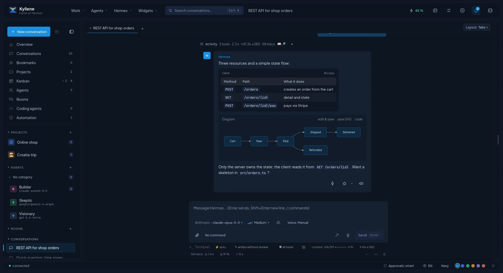 <br> **Chat**: tables, diagrams, live tool activity | 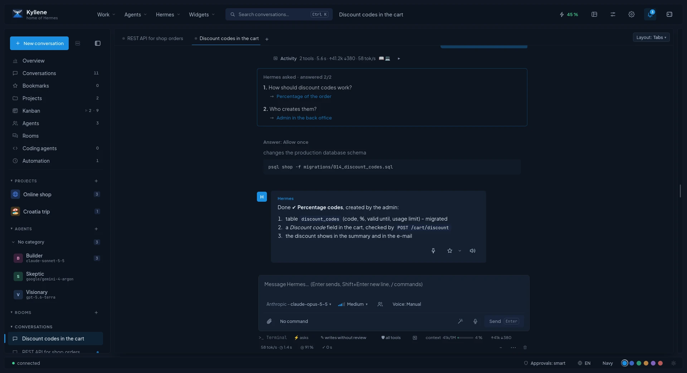 <br> **The agent asks, you decide** |
| 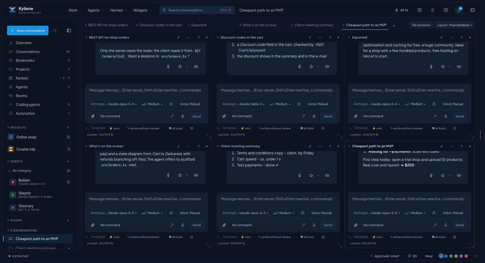 <br> **Many conversations at once** | 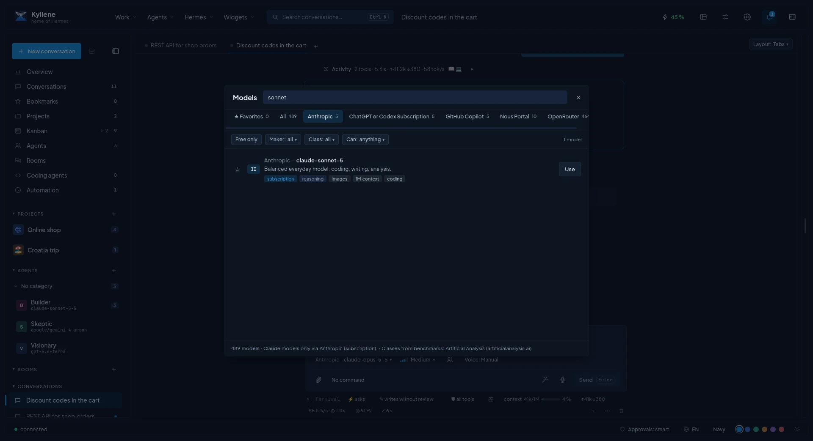 <br> **Every model, searchable** |
| 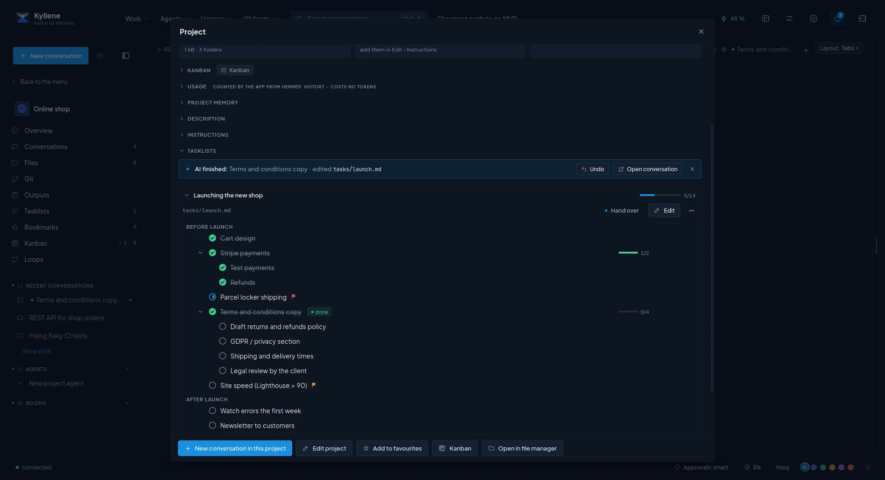 <br> **Tasklists: AI splits a task, with Undo** | 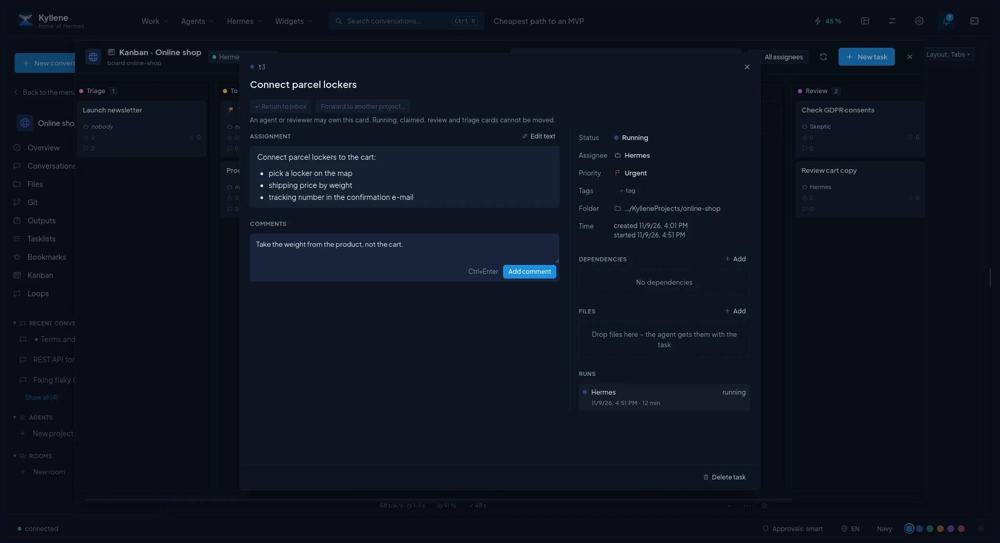 <br> **Kanban for agents** |
| 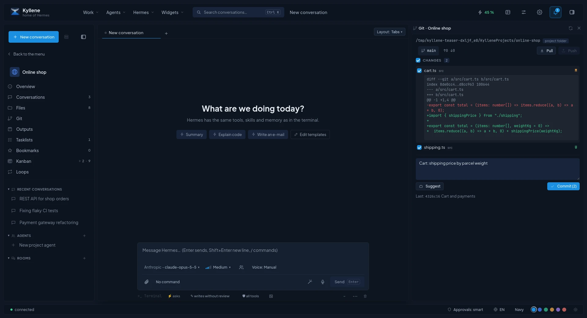 <br> **Git with AI commit messages** | 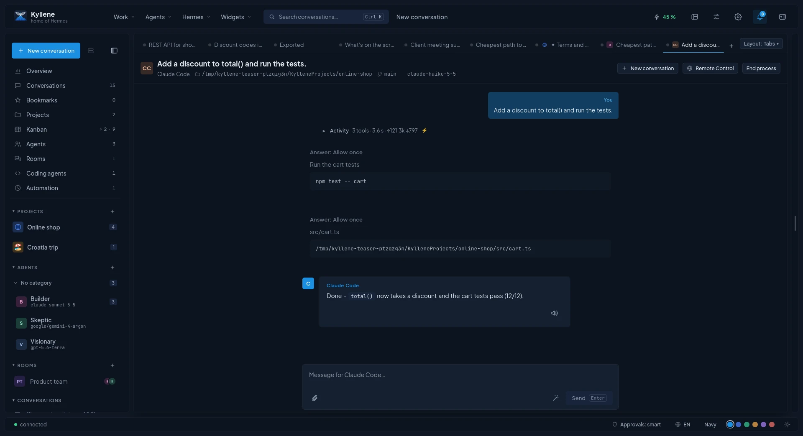 <br> **Claude Code inside** |
| 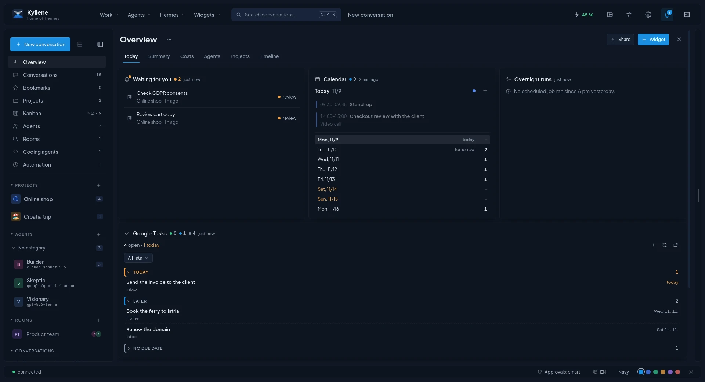 <br> **Overview: what waits for you today** | 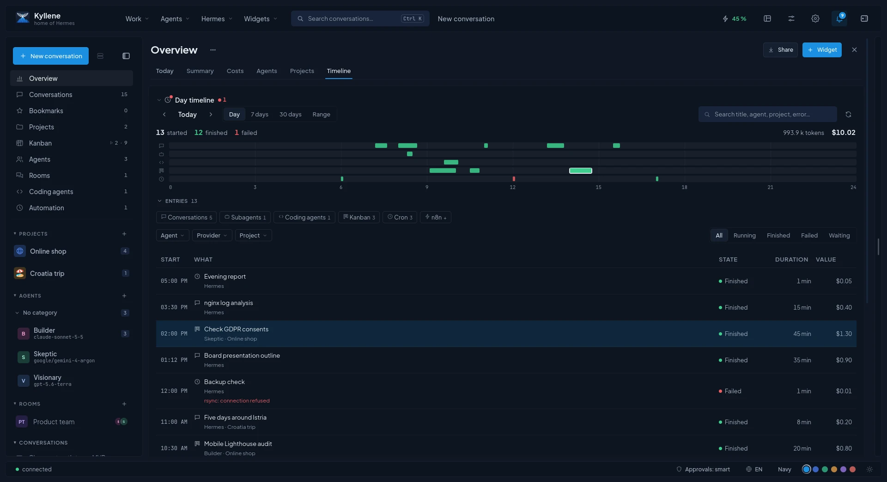 <br> **Timeline of the whole day** |
| 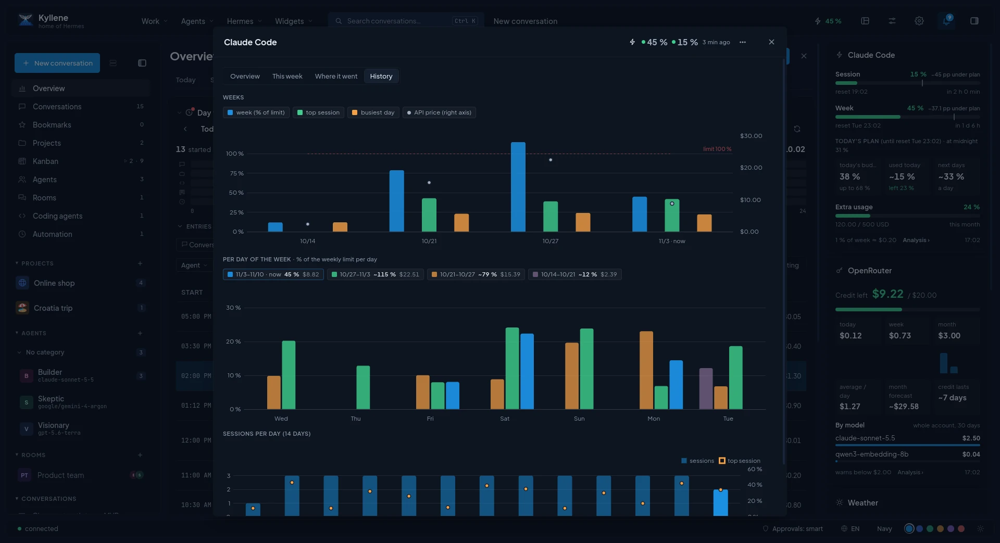 <br> **Limits and costs at a glance** | 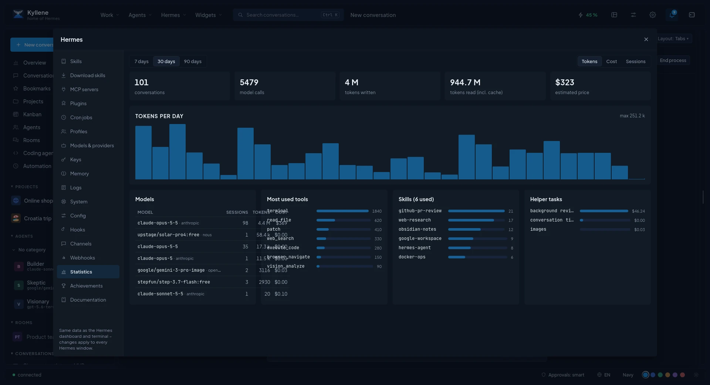 <br> **Manage Hermes without a terminal** |

## Get Kyllene

**Requirements:** Linux x86_64. The first beta is tested on Manjaro (GNOME, Wayland); the same AppImage is expected
to run on other modern distros, and the installer only warns there.

Install it with one line (no `sudo`, everything goes into your home folder):

```bash
curl -fsSL https://raw.githubusercontent.com/cpoint-eu/kyllene-releases/main/install.sh | bash
```

The [installer](install.sh) downloads the latest AppImage to `~/.local/bin/Kyllene.AppImage`, adds Kyllene with its
icon to your app menu and checks that AppImages can run (FUSE; Manjaro ships it). Then start **Kyllene** from the
app menu. [Hermes Agent](https://hermes-agent.nousresearch.com/) is not needed beforehand: when it is missing,
Kyllene offers to install it on the first start (about 2.7 GB, a few minutes) and then lets you sign in to a model
(**Connect a model**; the first provider you connect becomes the main model).

Kyllene **updates itself**: when a new version is out it shows what is new and offers *Update and restart*.
Every release is signed and tied to the Hermes versions it was tested with, so an update never lands on a Hermes it
cannot work with.

<details>
<summary>Other options: a specific version, manual download, uninstall</summary>

- A specific version: `curl -fsSL https://raw.githubusercontent.com/cpoint-eu/kyllene-releases/main/install.sh | bash -s -- --version v0.0.1-beta`
- An AppImage you already downloaded: `bash install.sh --appimage ~/Downloads/Kyllene_0.0.1-beta_amd64.AppImage`
- Without the installer: download `Kyllene_<version>_amd64.AppImage` from the
  [latest release](https://github.com/cpoint-eu/kyllene-releases/releases/latest), `chmod +x` it and run it.
- Uninstall (your data in `~/.local/share/kyllene` and Hermes in `~/.hermes` stay):

  ```bash
  curl -fsSL https://raw.githubusercontent.com/cpoint-eu/kyllene-releases/main/install.sh | bash -s -- --uninstall
  ```

</details>

### 🤖 Let your AI install it

Already using Hermes, Claude Code, Codex or another coding agent? Paste this to it:

```text
Install Kyllene for me by following the "Install guide for AI agents" in
https://github.com/cpoint-eu/kyllene-releases/blob/main/README.md
```

<details>
<summary><b>Install guide for AI agents</b> (exact steps; humans can follow them too)</summary>

You are installing Kyllene, a desktop app (AppImage) for Hermes Agent, for the user of this computer. Run the steps
in order, check each result, and stop and tell the user when a check fails. Do not use `sudo` unless a step says so,
and then ask the user first.

1. **Check the platform.** `uname -sm` must print `Linux x86_64`. Otherwise stop: only Linux x86_64 is supported for
   now. Tested on Manjaro; other modern distros are expected to work.
2. **Check for Hermes Agent.** `command -v hermes || ls ~/.local/bin/hermes`
   - Found: go on.
   - Missing: install it without questions (no sudo, a few GB in `~/.hermes`, needs `git` and `curl`;
     `--skip-setup` makes the installer non-interactive):

     ```bash
     curl -fsSL https://hermes-agent.nousresearch.com/install.sh | bash -s -- --skip-setup
     ```

     Then check `~/.local/bin/hermes --version`. The installer adds `~/.local/bin` to PATH only for new shells.
3. **Install Kyllene** with its installer (downloads the latest AppImage to `~/.local/bin/Kyllene.AppImage`, adds the
   menu entry and icon, checks FUSE; no sudo):

   ```bash
   curl -fsSL https://raw.githubusercontent.com/cpoint-eu/kyllene-releases/main/install.sh | bash
   ```

   It must end with `Done.` and exit code 0. When it stops instead, it says why:
   - *No Kyllene release is published yet*: stop and tell the user.
   - *FUSE is missing*: ask the user to install it (`sudo pacman -S fuse3` on Manjaro/Arch; Debian/Ubuntu
     `sudo apt install fuse3`; Fedora `sudo dnf install fuse3`), then run the installer again.
   - *belongs to another Kyllene install*: the user already has Kyllene built from source; ask before re-running
     with `bash -s -- --force`.
   - On a distro other than Manjaro it only warns and installs anyway.
4. **Start it:** `gtk-launch kyllene` (or run `~/.local/bin/Kyllene.AppImage` from the user's desktop session).
   A window titled Kyllene opens and connects to Hermes.
5. **Tell the user what is left for them:**
   - When Hermes has no model yet (fresh install), Kyllene shows the bar *Hermes has no model connected.*: the user
     clicks **Connect a model** and signs in to a provider (or adds an API key); the first connected provider also
     becomes the main model. This needs the user's own account or API key: never enter keys or passwords for them.
   - Kyllene updates itself: it offers *Update and restart* when a new version is out.

**Uninstall:** `curl -fsSL https://raw.githubusercontent.com/cpoint-eu/kyllene-releases/main/install.sh | bash -s -- --uninstall`.
The user's data in `~/.local/share/kyllene` and Hermes in `~/.hermes` stay; delete them only when the user asks.

</details>

## Documentation

- **[Documentation](docs/README.md)**: all guides and troubleshooting, among them every
  [setting](docs/settings.md), [managing Hermes](docs/hermes.md), [projects and tasklists](docs/projects.md),
  [Kanban](docs/kanban.md), [coding agents](docs/coding-agents.md), [sync](docs/sync.md), [voice](docs/voice.md),
  [quick capture](docs/quick-capture.md) and [shortcuts](docs/shortcuts.md).
- **[Build your own widget](docs/widgets.md)**: put anything on screen, with a ready-to-run example.
- **[Website](https://cpoint-eu.github.io/kyllene/)** ([česky](https://cpoint-eu.github.io/kyllene/cs/)): install, updates, uninstall and troubleshooting on one page.

## FAQ

**Is it free?** Yes.

**How is it different from Hermes Desktop?** [Hermes Desktop](https://hermes-agent.nousresearch.com/desktop) is the
official app by Nous Research and a fine general client. Kyllene is an independent app built around projects and
daily work: tasklists, Kanban, git, coding agents, several conversations at once, costs and widgets. Both talk to the
same Hermes, so you can use either, or both.

**Do I need an account or an API key from Kyllene?** No. Kyllene uses whatever models and keys your Hermes already has.

**Windows or macOS?** Planned. Linux first.

**Where is the source code?** The code is not public yet. This repository holds the releases and the issue tracker.

## Feedback and support

- Found a bug or have an idea? [Report a bug](https://github.com/cpoint-eu/kyllene-releases/issues/new?template=bug.yml) or [suggest an improvement](https://github.com/cpoint-eu/kyllene-releases/issues/new?template=idea.yml) — or use **Help** in the app's top bar.
- Kyllene is free and built in spare time. If it saves you time, you can support its development:

<p>
  <a href="https://ko-fi.com/cpointeu"></a>
</p>

<sub>Kyllene is an independent project and is not affiliated with Nous Research. Hermes Agent is a project of Nous Research.</sub>
