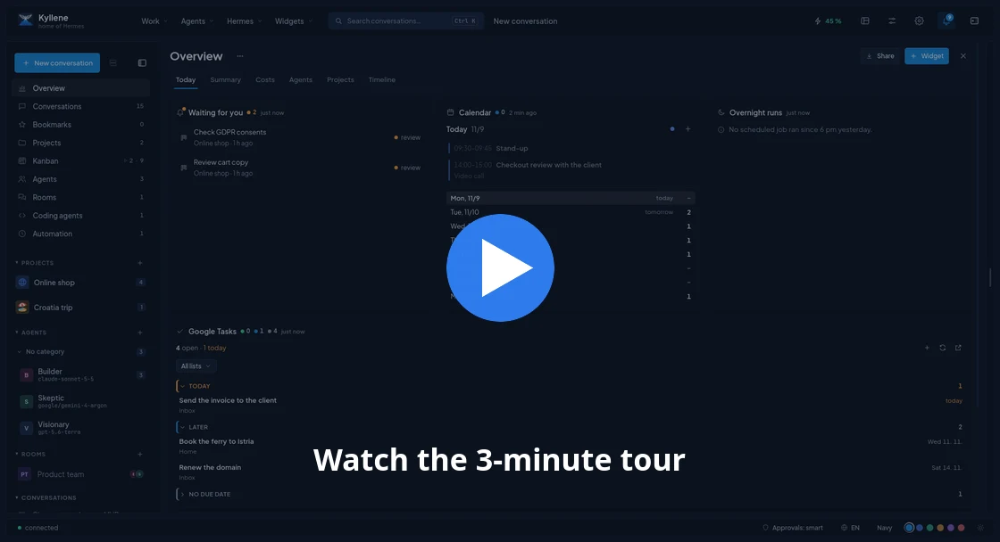

<p align="center">
  
</p>

<h1 align="center">Kyllene</h1>

<p align="center">
  <b>The desktop workspace for <a href="https://hermes-agent.nousresearch.com/">Hermes Agent</a>.</b><br>
  Projects, tasklists, Kanban, coding agents and many conversations at once, in one fast native window.
</p>

<p align="center">
  <a href="https://github.com/cpoint-eu/kyllene-releases/releases/latest"></a>
  
  
  
</p>

<p align="center">
  
</p>

<p align="center">
  <a href="media/kyllene-tour.mp4"></a><br>
  <sub>▶ <a href="media/kyllene-tour.mp4">Watch the 3-minute tour</a> (all data in the video and screenshots is made up)</sub>
</p>

---

## Why Kyllene

Hermes is a great agent. It remembers, learns new skills and works for you around the clock. But most of the time
you meet it in a terminal or a chat box, one conversation at a time.

Kyllene turns Hermes into a place where your work lives. Every project gets a home with its conversations, files,
tasklists, a Kanban board and git. You can run five conversations side by side, hand a task to an agent and come
back when it is done, see what each day cost, and manage all of Hermes without touching a config file.

It is the same Hermes underneath. Kyllene talks to your existing install, so sessions, memory, skills and profiles
are shared: start something in Kyllene and continue it in the terminal, or the other way round. No lock-in, no
account, no cloud of its own.

*Kyllene is the mountain in Arcadia where Hermes was born. Hence the tagline: home of Hermes.*

## Hermes alone vs. Hermes in Kyllene

| | Hermes in a terminal | Hermes in Kyllene |
|---|---|---|
| **Conversations** | One per terminal window | Tabs, a grid or free windows; pop any conversation out into its own window |
| **Answers** | Text and ASCII | Rendered Markdown: tables, Mermaid diagrams, highlighted code, a live panel of every tool call |
| **Questions and approvals** | Type the answer or `y`/`n` | Clickable choices, approval cards, a diff of every file change before it is written |
| **Models** | `/model` and a model name | Search all providers with price, context and benchmark class; compare two models on one prompt |
| **Projects** | A folder you `cd` into | A project home: conversations, files with previews, outputs gallery, git, tasklists, Kanban |
| **Background work** | `hermes kanban` commands | A drag-and-drop board; agents run cards in the background and ping you when they need you |
| **Coding agents** | Separate terminals | Claude Code and Codex inside the app, with the same approval cards |
| **Managing Hermes** | Editing YAML, CLI commands | Skills, MCP servers, plugins, cron, profiles, keys, memory, logs and gateways in one screen |
| **Costs and usage** | Numbers per session | Overview of tokens and costs by model, agent and project; subscription limits with a pace line; a timeline of the whole day |
| **Several computers** | Each one on its own | Projects, tasklists, settings and widgets sync through GitHub or your cloud drive |

## Features

### Conversations

- Answers stream live with tables, Mermaid diagrams and syntax-highlighted code; copy, save or edit a diagram.
- **Activity panel** shows every tool call as it happens: what ran, how long it took, what it returned.
- The agent asks with **clickable choices**; risky commands wait for your OK; file writes can be reviewed as a diff.
- **Many conversations at once**: tabs, a grid, free windows, or a conversation in its own window.
- **Search everything** with `Ctrl+K`: conversations, projects, files, tasklists and every command.
- **Quick capture**: a global shortcut takes a screenshot, you add a question, the answer appears in a small window.
- Attachments and pasted images, prompt templates, bookmarks, export, `/later` (continue at a set time or when a background job ends).
- A conversation keeps running when you close the app; drafts and attachments survive restarts.

### Models

- One picker for every provider Hermes knows: search, description, price, context window, capabilities.
- Benchmark classes and favourites; switch the model of a running conversation in one click.
- **Compare**: send one prompt to two models side by side and continue with the winner.

### Projects and tasks

- A project = a folder with its conversations, files (with previews), an **outputs gallery** of everything the agents made, and a **git panel** (diff, commit message written by AI, every write confirmed first).
- **Tasklists** in plain Markdown: the agent ticks items off while it works; you edit them like a document.
- **Ask AI on any task**: split it into subtasks, rephrase or estimate; edits land in the file, with Undo.
- **Kanban**: hand cards to agents; they run in the background, ask when they are stuck, and you review the result. Watch any run live in its own window.
- **Focus mode** hides everything outside the current project and mutes its notifications.

### Agents

- Hermes profiles as **agents** with their own model, memory and personality; group them in categories and rooms.
- **Claude Code and Codex** run inside the app with approvals, slash commands and their history.
- Delegated sub-agents and background processes are visible in the conversation while they run.

### Overview and widgets

- **Overview**: tokens, costs (at API prices), usage by model, agent and project, running work, and a **Today** page with what waits for you.
- **Timeline**: what Hermes, your agents, cron jobs and Kanban runs did all day, with the cost of each entry.
- **Widgets**: Claude Code, Codex and OpenRouter limits with a pace line (will it last until the reset?), weather, Google Calendar, Gmail and Google Tasks. Write your own widgets with a small script.

### Manage Hermes

- Skills and the skills hub, MCP servers (with per-tool selection), plugins, cron jobs, profiles, API keys, memory, logs, hooks, webhooks, config and stats, all without a terminal.
- Hermes on your own servers over SSH, and threads from Discord and other gateways as normal conversations.
- After every Hermes update Kyllene checks that everything it uses still works and tells you if something broke.

### Voice

- Dictation with a local Whisper model (on the GPU if you have one), answers read aloud, three voice modes up to hands-free.
- Transcribe recordings with speaker detection.

### Safety and privacy

- Approval of commands, a read-only safety mode per conversation, review of file writes, and a warning before sensitive data leaves for a model provider.
- **No telemetry, no account, no server.** Kyllene talks only to your Hermes. The only call home is the update check, a static file on GitHub.

### Make it yours

- Light and dark mode, colour schemes and a theme editor, a layout you can rearrange, keyboard shortcuts for everything.
- English and Czech.

## Screenshots

| | |
|---|---|
|  <br> **Chat**: tables, diagrams, live tool activity |  <br> **The agent asks, you decide** |
|  <br> **Many conversations at once** |  <br> **Every model, searchable** |
|  <br> **Tasklists: AI splits a task, with Undo** |  <br> **Kanban for agents** |
|  <br> **Git with AI commit messages** |  <br> **Claude Code inside** |
|  <br> **Overview: what waits for you today** |  <br> **Timeline of the whole day** |
|  <br> **Limits and costs at a glance** |  <br> **Manage Hermes without a terminal** |

## Get Kyllene

**Requirements:** Linux x86_64 and [Hermes Agent](https://hermes-agent.nousresearch.com/). The first beta is
tested on Manjaro (GNOME, Wayland); the same AppImage is expected to run on other modern distros.

1. Install Hermes Agent, if you do not have it yet:

   ```bash
   curl -fsSL https://hermes-agent.nousresearch.com/install.sh | bash
   ```

2. Download `Kyllene_<version>_amd64.AppImage` from the
   [latest release](https://github.com/cpoint-eu/kyllene-releases/releases/latest).
3. Make it executable and start it:

   ```bash
   chmod +x Kyllene_*_amd64.AppImage
   ./Kyllene_*_amd64.AppImage
   ```

Kyllene **updates itself**: when a new version is out it shows what is new and offers *Update and restart*.
Every release is signed and tied to the Hermes versions it was tested with, so an update never lands on a Hermes it
cannot work with.

Coming next: a one-line installer with a menu entry, and Hermes installed from inside the app. The full guide
will live at **[cpoint-eu.github.io/kyllene](https://cpoint-eu.github.io/kyllene/)**.

## FAQ

**Is it free?** Yes.

**How is it different from Hermes Desktop?** [Hermes Desktop](https://hermes-agent.nousresearch.com/desktop) is the
official app by Nous Research and a fine general client. Kyllene is an independent app built around projects and
daily work: tasklists, Kanban, git, coding agents, several conversations at once, costs and widgets. Both talk to the
same Hermes, so you can use either, or both.

**Do I need an account or an API key from Kyllene?** No. Kyllene uses whatever models and keys your Hermes already has.

**Windows or macOS?** Planned. Linux first.

**Where is the source code?** The code is not public yet. This repository holds the releases and the issue tracker.

## Feedback and support

- Found a bug or have an idea? [Open an issue](https://github.com/cpoint-eu/kyllene-releases/issues).
- Like Kyllene? You can [buy me a coffee on Ko-fi](https://ko-fi.com/cpointeu). ☕

<sub>Kyllene is an independent project and is not affiliated with Nous Research. Hermes Agent is a project of Nous Research.</sub>
