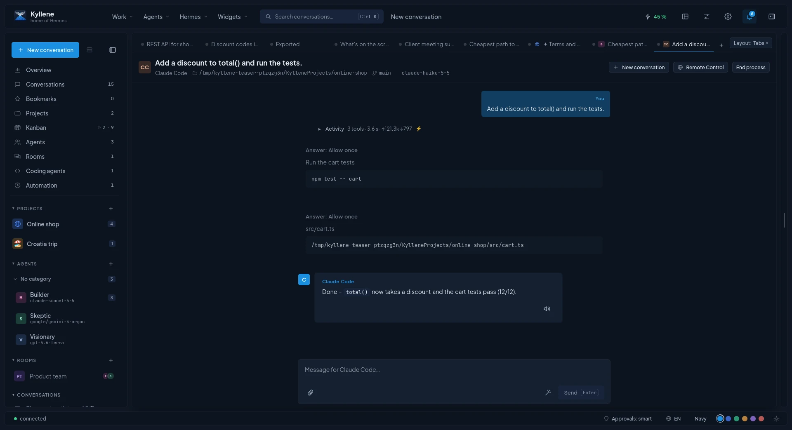

# Coding agents

Kyllene runs **Claude Code** and **OpenAI Codex** inside the app, next to your Hermes conversations: the same
composer, live tool activity, approvals in the thread, their slash commands, and their whole history.

## What you need

Each agent needs, on this computer:

1. **Its command installed**: `claude` (Claude Code) or `codex` (Codex CLI).
2. **Its own sign-in**: run `claude` or `codex` once in a terminal and log in.
3. **A signed-in Hermes provider** for it: Anthropic for Claude Code, ChatGPT/Codex for Codex. Connect it in
   [Hermes › Models & providers](hermes.md#models--providers).

[Settings › Coding agents](settings.md#coding-agents) shows for each agent what is ready and what is missing, plus
its current limits. **Check again** after you install or sign in.

## Conversations

Open **Coding agents** in the left menu. It has four tabs:

| Tab | What it shows |
|---|---|
| **In Kyllene** | Conversations you started or continued in Kyllene. |
| **History** | Every Claude Code and Codex conversation on this computer, read from the agents' own logs, also those from the terminal. *This project only* narrows it to the current project's folder. |
| **Running** | Open agent tabs and agents working right now: folder, branch, card or task, state, tokens. |
| **Loops** | Unattended loops on this computer: round, current step, *Pause after the current step* / *Continue* / *Stop now*. See [Loops](#loops). |

- **New conversation** asks for the folder the agent works in: your Kyllene projects, recently used folders and the
  subfolders of the [folders with projects](settings.md#coding-agents) are offered.
- A conversation from **History** can be **continued in Kyllene** (the next message continues it in the same agent)
  or **taken over into Hermes** (copied into a normal Hermes conversation that Hermes continues).
- **Process a tasklist task with …** (palette): pick a project, then one of its open tasklist tasks; the agent starts
  on it in the project folder. Tasks that wait for unfinished ones are marked.
- Inside a project or in a coding conversation the palette offers *New conversation with Claude Code in project …*
  and *… in this folder*, so you skip the folder picker.
- **End process** stops the agent's process and whatever it started; the next message continues the conversation.
- **Remote Control** (Claude Code): continue the conversation on claude.ai or in the Claude app on your phone;
  prompts written there show up here. Needs Claude Code's own claude.ai login.

## Coding agents and Kanban

A [Kanban](kanban.md) card can be handed to a coding agent: **Process with …** gives it its own git worktree and
branch of the project's code repository; the card moves to *Running* and to *Review* when the agent finishes.
**Review with …** lets another agent review that branch read-only and writes its findings into the card's comments.

## Loops

A **loop** lets coding agents work through something unattended, in rounds, until a condition says it is done, for
example "until the tasklist has no open item". It keeps running when you close Kyllene (as a background service of
your desktop session).

- **Where**: *Loops* in a project's menu (the workflow editor), the **Loops** tab of the Coding agents window (the
  runs), or the palette *Loops: workflow editor* / *Loops: running loops*.
- **Editor**: boxes connected with arrows. *Start*; *Step* (who works: Claude Code, Codex, a Hermes profile or a
  shell command, with the task, model, permissions, allowed tools and a time limit); *Condition* (the tasklist has no
  open item, a command ends with exit code 0, the last step went fine, the agent asked a question; a *yes* and a *no*
  way); *Loop* (the safety limits: *Max rounds*, *Max time*, *Stop after rounds without progress*, *Max spend*,
  *Commit after each round*); *End*. **From template** gives the ready-made *Claude Code → finished tasklist* (max 10
  rounds, stops after 2 rounds without progress). *Start* stays disabled until the workflow is valid (one start,
  every way ends, every cycle goes through a Loop box).
- The workflow is saved in the project as `.kyllene/workflows/<name>.json`, so it travels with the project.
- **Runs**: round x of max, the current step, time and spend; *Pause after the current step*, *Continue*, *Stop
  now* and the *Log* of every step. With *Pause when the agent asks*, an answer that ends with a question pauses the
  run and notifies you; your answer goes to the same step again.
- Each round is a fresh, non-interactive run of the agent. Agents in a loop **never push**: `git push` is denied.

## Limits

The **Claude Code** and **OpenAI Codex** widgets show your plan limits with a pace line: is your usage on track to
last until the reset? They read the logins on this computer; switch them on in the **Widgets** menu.
