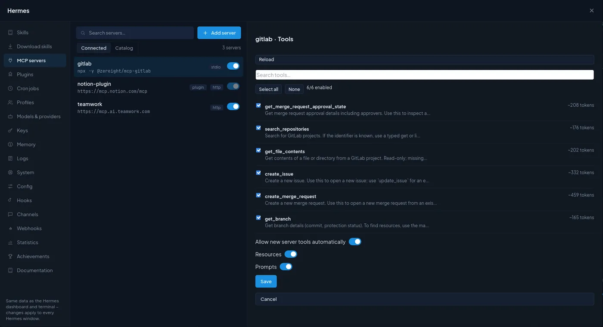
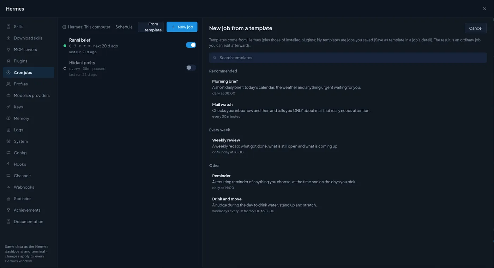
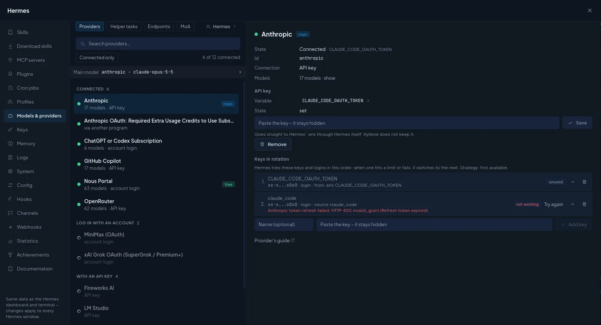
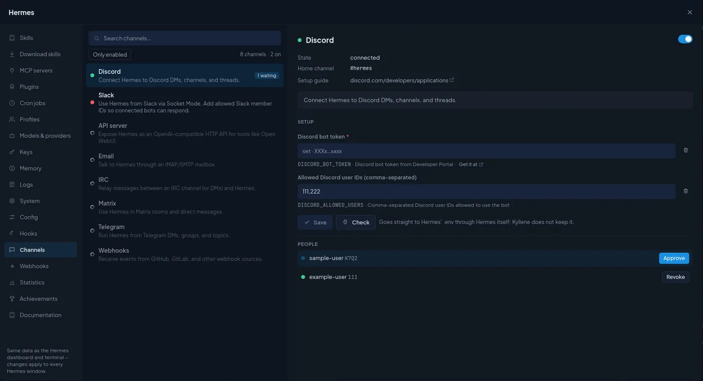

# Manage Hermes in Kyllene

Everything you would otherwise do in Hermes' terminal or its web dashboard (skills, MCP servers, plugins, cron
jobs, profiles, keys, memory, logs, hooks, webhooks, messaging channels, config) is in the **Hermes** window.

Open it with the sliders icon in the top bar, `Ctrl+Shift+H`, the top menu **Hermes**, or the palette (`Ctrl+K`,
every tab has its own entry). The window works on the **same data** as the Hermes dashboard and terminal: a change
here applies to every Hermes window, and a change made in the terminal shows up here.

Most tabs are a list on the left and the detail of the selected item on the right. Where Hermes has a catalog, a
switch at the top flips between what you have (*Installed* / *Connected*) and what you can add (*Catalog*).

**Whose settings?** Hermes keeps skills, keys, models, memory and hooks per **profile** (an agent). Tabs that work
per profile have a **Hermes** button at the top: it shows whose data you see and lets you switch to another agent.

**Secrets** (API keys, tokens) you type in this window go straight into Hermes' `.env` through Hermes itself, in
masked fields. Kyllene never keeps them and never shows them again, only Hermes' short preview (`sk-…a1b2`).

**Tabs:** [Skills](#skills) · [Download skills](#download-skills) · [MCP servers](#mcp-servers) ·
[Plugins](#plugins) · [Cron jobs](#cron-jobs) · [Profiles](#profiles) · [Models & providers](#models--providers) ·
[Keys](#keys) · [Memory](#memory) · [Logs](#logs) · [System](#system) · [Config](#config) · [Hooks](#hooks) ·
[Channels](#channels) · [Webhooks](#webhooks) · [Statistics](#statistics) · [Achievements](#achievements) ·
[Documentation](#documentation)

## Skills

Skills are Hermes' procedural memory: a `SKILL.md` with instructions it loads when a task matches.

- The list is grouped by category, with a search, a filter by **origin** (*Built-in*, *Own* = written by the agent
  or by you, *External folder*, *From the hub*) and **Only switched off**. The switch in each row turns a skill off
  or on for this profile.
- The detail shows the origin, category, how often it was used, its folder, the description and the full text
  (**Source** flips between the formatted text and the raw `SKILL.md`). Own skills can be edited and deleted;
  built-in ones only switched off (a Hermes update would overwrite an edit).
- **New skill**: *Name*, *Category*, *When to use it* (one line starting with "Use when …"; Hermes decides from it
  when to load the skill) and *Instructions*.

## Download skills

The Skills Hub: skills other people and Nous Research published.

- **Recommended** (Hermes' picks from all hub sources), **Official catalog** (every optional skill shipped with
  Hermes, by category), or search the hub by a word (*pdf*, *calendar*).
- The detail shows the source, its trust level and a **safety check** with every finding (for example "pip install
  without version pinning", with the file and line) and the full text, **before** you install.
- **Install** downloads the skill into this computer's Hermes; **Update skills** updates every skill installed from
  the hub.

## MCP servers

MCP servers give Hermes new tools (GitLab, Notion, a database, your own service).

- **Connected**: your servers with their type (*stdio* = a local program, *http* = remote) and a switch. Adding,
  removing or switching off applies within a minute; editing an enabled server needs a gateway restart (Kyllene
  tells you).
- **Add server**: *Name*, *Type* (*Remote (URL)* with an address, or *Local program* with a command),
  *Environment variables* (one `NAME=value` per line; keys go to `.env`) and *Login* (*No login*; *API key in header*, a token sent with every request and stored in `.env`; or *OAuth login*,
  where Hermes opens a browser once and you approve access).
- **Catalog**: ready-made servers (Asana, Airtable, n8n…) with what each needs; most sign in with OAuth.
- **Test connection** connects, lists the tools and disconnects.
- **Tools**: choose which of the server's tools Hermes may use. Each tool shows its description and roughly how
  many tokens its definition costs in every request, so switching off tools you never use makes every turn cheaper.
  *Allow new server tools automatically*, *Resources* and *Prompts* decide what else the server may add.
- **Activate in open conversations** connects a new server in conversations that are already open, without
  restarting them (Hermes otherwise picks it up only in new conversations).

## Plugins

- **Installed**: your own plugins and Hermes' built-in ones, with a switch each. A plugin marked *not activated*
  is installed but off.
- **Providers** at the top: the active **memory provider** (set up in [Memory](#memory)) and the **context
  engine** (how long conversations are compressed). Both are chosen when a conversation starts, so a change applies
  to new conversations.
- **Catalog**: plugins you can install, with **Official only** (maintained by Nous Research) and **Desktop too**
  (plugins for the official Hermes Desktop app, which do nothing in Kyllene and are hidden by default).
- A plugin with settings or its own MCP server shows them in its detail; **Activate in open conversations** connects
  it in conversations that are already open.

## Cron jobs

A cron job sends Hermes a prompt on a schedule (a morning brief every day at 7:00, a mail watch every 30 minutes)
and delivers the answer where you choose. Jobs are run by the Hermes **gateway**; the top line shows on which Hermes
(this computer or a [server](settings.md#servers)) and whether its scheduler is running.

- **From template**: Hermes' templates (Morning brief, Mail watch, Weekly review, Reminder, Drink and move…) and
  **My templates** (jobs you saved with *Save as template*, on every computer). The result is an ordinary job you
  can edit.
- **New job**:

| Field | What it does |
|---|---|
| **Agent / Script** | *Agent*: a model runs the prompt on every run (costs tokens). *Script*: Hermes runs a script from its scripts folder without any model; its output is the result. |
| **Name**, **What should Hermes do** | Each run is a new conversation without context, so write the prompt so it stands on its own. |
| **Schedule** | A cron expression (`0 7 * * *`), an interval (`every 30m`), weekly (`every monday 9am`) or one-off (`in 2h`, `2026-11-01T09:00`); the chips fill in common ones. |
| **Deliver to** | *Only save* or a connected messaging platform ([Channels](#channels)). |
| **Skills**, **Model**, **Thinking** | What the run loads and which model runs it (empty = Hermes' default). |
| **Run the agent** | *Always*, *When a script changes* or *When a URL changes*: the cheap check runs on schedule without a model and the agent runs only once the output changes. The cheapest way to watch something. |
| **Folder**, **Runs** | The working folder of the run, and how many runs before the job stops (empty = keep running). |
| **Create paused** | Create it switched off. |

- A job's detail has **Run now**, **Edit**, **Save as template**, **Delete** and its **History**; a click on a run
  opens its output in the right panel.

## Profiles

Every Hermes profile is an **agent** with its own model, personality, memory, skills and keys.

- The list shows each profile with its model and description, grouped by your categories (**Category actions**).
- **New profile** is a short wizard: *Basics* (name, description, model, start from a fresh profile or a copy,
  take over the keys), then *MCP servers*, *Skills*, *Channels*, *Variables* and a *Summary*. The description
  matters: Hermes uses it to decide which profile gets a Kanban task.
- The detail: the model (changeable), its own **Thinking** level (how hard its model thinks in its new conversations;
  **Hermes default** removes it, and the agent then runs on Hermes' default level, not on the one in
  [Settings › Models](settings.md#models)), whether its gateway runs, its folder, description, **Personality**
  (`SOUL.md`, who the agent is and how it talks), its skills and tool sets with switches, and its own variables
  (`.env`). Changes apply to the profile's new conversations.
- **Export** saves a profile to an archive (choose settings, skills, memory, cron jobs, code); secret values are
  never put in. **Import** creates a profile from such an archive or from `hermes profile export`.
- **Agent detail** opens the agent's own window (look, skills, memory, cron, groups); its **Basics** tab has the same
  model, **Thinking** and personality. **Open in a new window** in its header moves it into a window of its own;
  there, changing the model and an AI picture are done in the main window.

## Models & providers

Who Hermes can talk to, and which model does what.

- **Providers**: every provider Hermes knows, connected ones first (*Connected only* hides the rest). Sign in with
  an account (ChatGPT/Codex, Nous Portal…) or paste an API key; *Provider's guide* explains where to get one. A
  connected provider shows its models, its keys **in rotation** (Hermes tries them in order and switches when one
  hits a limit or fails; *Try again* clears an error, the arrows change the order) and *Remove*.
- **Helper tasks**: which model does the side work (image reading, context compression, conversation titles, smart
  approvals, the review after a turn, Kanban task splitting…). *auto* = the main model; give cheap work a cheaper
  model here.
- **Endpoints**: your own OpenAI-compatible server, such as a local LM Studio, Ollama or vLLM, or a company proxy.
- **MoA** (Mixture of Agents): presets where several reference models answer at once and an aggregator merges
  their answers, with temperatures and a time limit.

The main and backup model for new conversations are set in [Settings › Models](settings.md#models).

## Keys

Every variable in Hermes' `.env`, grouped (*Model providers*, *Tools*, …) with what each is for. **Only set** shows
the ones with a value, **Advanced** adds base-URL overrides and debug switches. A key's detail sets a new value or
**Remove**s it (also from Hermes' credential pool). **Add key** stores your own variable, for example a token a
skill or MCP server needs.

## Memory

What Hermes remembers between conversations. It reads both lists at the start of every conversation.

- **Agent's notes** (`MEMORY.md`) and **About you** (`USER.md`), each entry with **Edit** and **Delete**, plus
  **Add an entry**. The counter shows how full each list is (Hermes has a size limit).
- **External memory**: a memory provider on top of the built-in lists (from a plugin). Hermes refuses a provider
  that is not ready; new conversations pick up the change.
- The **Hermes** button at the top switches to another agent's memory.

## Logs

Hermes' logs: the file (`agent.log`, gateway…), minimum level, one part of Hermes, how many lines, a search, and
**Follow** to keep reading new lines. The first place to look when something does not work.

## System

- **Hermes**: version, whether an update is available (with what it would bring), how it was installed, the config
  version, its home folder. **Update** runs `hermes update`, **Check** looks for a new version, **Doctor** runs
  `hermes doctor` (config, keys, dependencies, services).
- **Gateway**: state, mode, running sessions, health. The gateway runs cron jobs, Kanban tasks and messaging bots.
  **Restart gateway** (`hermes gateway restart`) interrupts the cron jobs, Kanban tasks and bot conversations
  that are running at that moment. When Hermes was updated but the gateway still runs the previous version, Kyllene
  warns (*Hermes is running old code*) and offers **Restart…**; until you restart it, some actions such as switching
  models can fail.
- **Computer**: machine, CPU, memory, disk, uptime, Python.

**Update**, **Doctor** and **Restart gateway** run one at a time, with a live log. When you close the window while one
runs and open it again, it shows that action and its log; another one cannot start until it ends. The same holds for
**Update Hermes** in Kyllene's update window: while Hermes management runs an action, it says so and points here.

**Open in a new window** in the header of the *System* tab (or `Ctrl+K` › *Hermes › System in a new window…*) moves
the tab into a window of its own, for example to watch a long update. The *System* tab in the main window then only
offers **Show the window**. ✕ closes only the window and the action goes on; when it ends, the bell says *Hermes ›
System: done* (or *failed*). **Back to the main window** in the window's header returns it.

Kyllene checks itself after every Hermes update and tells you if something it uses changed. The Hermes versions a
Kyllene release was tested with are in [Settings › About](settings.md#about).

## Config

All of Hermes' `config.yaml`. **Form** lists every setting by section (General, Agent, Terminal, Display, Voice,
Text to speech, Speech to text, Memory, Security…) with Hermes' own description; **Changed** shows only what you
set yourself. **Text** edits the YAML directly. Only changed values are written; the rest of the file stays as it is.

## Hooks

Scripts Hermes runs when something happens. A hook runs on your computer with your rights, so add only scripts you
know.

- **Shell**: a command for an event (`post_tool_call`, `on_session_end`…), optionally only for some tools (a regex
  such as `terminal|write_file`), with a timeout. Hermes runs a hook only after you **approve** it once (*Approve
  now* in the form). **Try it** fires it with a sample event; **Check hooks** runs `hermes hooks doctor`.
- **Gateway**: Python hooks in `~/.hermes/hooks` that react to gateway events (`agent:start`, `agent:end`…); a broken
  one shows why.
- **Outbound webhooks**: send Hermes' events to your URL (signed or not).

## Channels

Messaging platforms Hermes can be reached through (Hermes calls this the gateway): Discord, Telegram, Slack, e-mail,
Matrix, WhatsApp, Signal and more than twenty others.

- Each channel shows its state and a switch. The detail has the setup fields (tokens, allowed users) with a link to
  where you get them, **Save** and **Check** (asks Hermes whether it is connected).
- **People**: users waiting for approval (**Approve**) and approved ones (**Revoke**).
- Threads of Hermes' bots on this computer or on a server show up under **Gateway** in the left menu (the last 30
  days; search finds older ones). They open as normal conversations, and what you write there goes to the channel
  too.

## Webhooks

Let other services (GitLab, GitHub, n8n…) wake Hermes with an HTTP call. Webhooks are off until you **Switch on**
(this restarts the gateway). **New webhook**: *Name*, *Events* to accept, *What should Hermes do* (`{placeholders}`
take values from the payload; empty = the raw payload goes to the agent), where the answer goes and which skills it
loads. The detail shows the address to give the other service, its signature secret and **Send a test**.

## Statistics

Conversations, model calls, tokens and the estimated price over 7, 30 or 90 days; tokens per day; usage per model,
the most used tools and skills, and what the helper tasks cost. Kyllene's own **Overview** has more (per agent, per
project, limits).

## Achievements

Hermes' achievements (tool chains, debugging, autonomy…) with tiers and progress. **Rescan** scans your
conversations again; **New achievement** creates your own (see
[Settings › Widgets](settings.md#widgets) › Custom achievements).

## Documentation

Hermes' own documentation, readable and searchable inside the app; **Open online** opens the same page on
hermes-agent.nousresearch.com.
