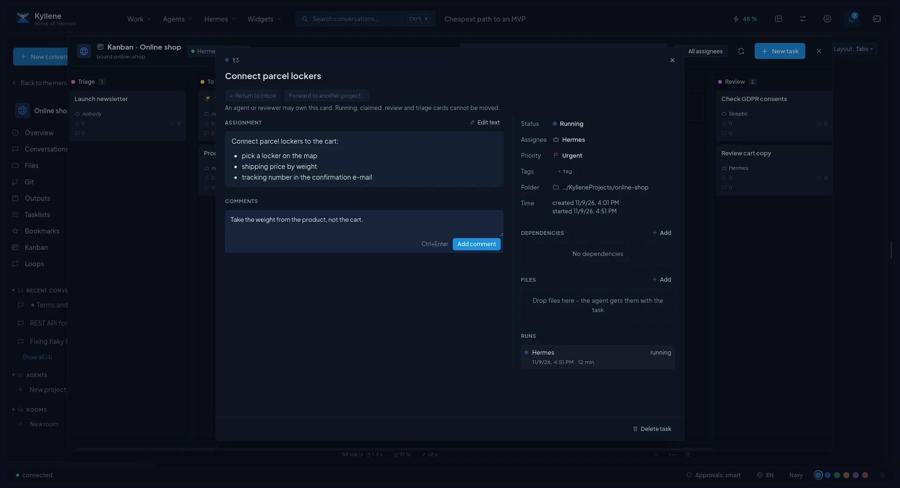

# Kanban

Kanban hands work to agents. Each card is a task with an assignment; Hermes starts it with the agent (profile) you
pick, the agent works in the background, asks when it is stuck, and you check the result. It uses Hermes' own Kanban
boards, so the same cards are visible in Hermes' terminal and dashboard.

## Boards

- Every project can have **its own board** (*Kanban* in the project's menu; *Create board* the first time). Agents
  working on its cards use the project folder, or their own copy of the project's code repository for coding roles
  (see [Projects › Basics](projects.md#the-project-window)).
- The **Inbox** is the shared board for work that does not belong to a project yet. Anything you capture as a
  Kanban task lands there parked: nothing starts it on its own. **To triage** shows only open unassigned cards and
  cards returned from projects.
- **Kanban** in the left menu opens the boards; the palette has *Kanban: <project>* and *New task in Inbox*.

The header says whether **Hermes runs tasks**: cards are started by the Hermes gateway's dispatcher. If it says
*tasks will not run*, start the Hermes gateway (`hermes gateway`, or its service) with Kanban dispatch enabled.

## Columns

| Column | Meaning |
|---|---|
| **Triage** | New ideas to sort out, not started. |
| **To do** | Planned work. An agent starts it only after you move it to *Ready*. |
| **Scheduled** | Waits for its time. |
| **Ready** | Hermes starts it with the assigned profile as soon as it can. |
| **Running** | An agent is working on it now; Hermes moves it when the agent finishes. |
| **Blocked** | The agent needs something: a question to you is marked and sorted to the top. |
| **Review** | Done by the agent, waits for your check. |
| **Done** | Finished. |
| **Archived** | Hidden from the board, kept with its history. Only finished cards can be archived; **Restore** brings one back. |

Drag a card to another column to change its state.

## Working with cards

- **New task**: what should be done, details for the agent (Markdown), who works on it (a Hermes profile) and the
  priority. The card waits in *To do* until you move it to *Ready*.
- The **card detail** shows the assignment, the result, subtasks, comments, dependencies (cards it waits for) and
  every **run**. *Open the run's progress* follows the agent live; **Separate window** keeps the run next to the
  board; after the run you can **Open as conversation** and continue it.
- When the agent asks, the card shows the question with its choices: **Answer and resume** sends your answer and
  starts the card again. A comment you add is read by the agent on its next run.
- **Process with …** hands the card to a coding agent (Claude Code or Codex) in its own git worktree and branch;
  the card moves to *Running* and to *Review* when it finishes. **Review with …** lets another agent review that
  branch read-only and puts its findings into the comments. See [Coding agents](coding-agents.md).
- **Send to project…** moves an Inbox card to a project board (parked, or to *Triage* to be split up); **↩ Return
  to Inbox** sends it back.
- A tasklist task sent to Kanban (**Send to Kanban** in the tasklist) is ticked by itself once its card is
  finished.

## Old cards

Archived cards are kept until you delete them: *Delete older than …* in the *Archived* column header for one board,
or automatic clean-up for all boards in [Settings › Automatic deletion](settings.md#automatic-deletion) (off by
default).

Notifications about finished, blocked or failed cards: [Settings › Notifications](settings.md#notifications).
