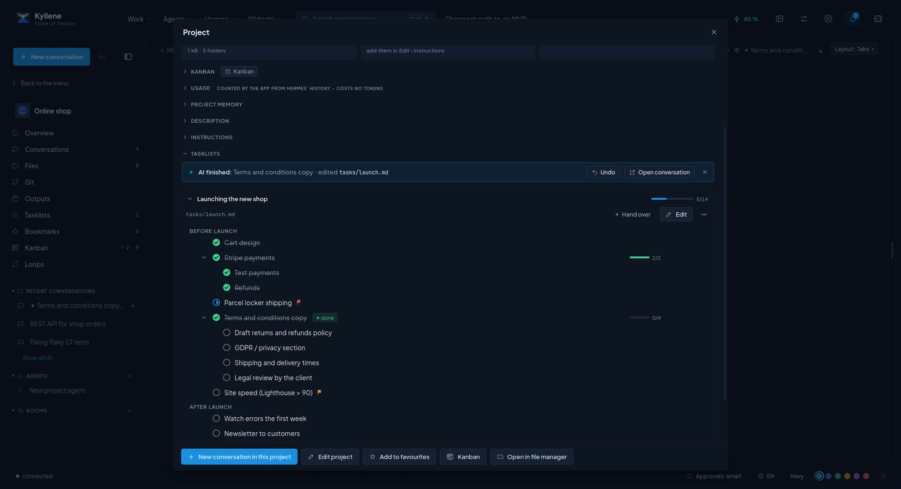

# Projects and tasklists

A **project** is a folder on your disk with everything that belongs to one piece of work: its conversations, files,
instructions for the agent, a memory, tasklists and a Kanban board. Conversations started in a project work in its
folder, so the agent sees its files.



## Create a project

Click **+** next to *Projects* in the left menu (or the palette: *New project*). Fill in a name, an optional
description and a colour; the folder is suggested in your projects folder ([Settings ›
Projects](settings.md#projects)) and created if missing. You can also pick an existing folder.

A click on a project in the left menu **opens it in the menu**: the menu shows the project's own navigation
(*Overview*, conversations, files, tasklists, Kanban, Outputs, Git) and **‹ Back to the menu** returns. While you
are inside a project, **New conversation** (the menu's +, the + in the tab strip, `Ctrl+N`) starts the conversation
in that project.

## The project window

**Edit project** (from the project's ⋯ menu or its overview) has these tabs:

| Tab | What it holds |
|---|---|
| **Basics** | Name, description, folder. **Code repository**: a git repository with the project's code when it is not the project folder itself (coding Kanban cards then work in their own copy, a worktree, of this repository). **Coding roles**: which Kanban agents count as coding ones. **Show even if ignored**: files `.gitignore` hides but the file lists should show. **Review file writes**: before Hermes writes or changes a file in this project's conversations, it shows the diff and waits for your OK. **Safety mode**: which tools the agent may use here (for example read-only). A single conversation can override both in the bar under the message box. |
| **Look** | Colour, and an icon: a symbol, an emoji, your own image, or one generated by Hermes' image model. |
| **Instructions** | **Default agent**: new conversations in the project start with this agent (its model, personality and skills). Below it the rules and context Hermes reads at the start of every new conversation in the project (who it is for, conventions, what to watch out for). If the folder already has instructions from another tool (Claude Code's `CLAUDE.md`, `AGENTS.md`), Hermes uses those and your edits go there. |
| **Memory** | Facts, decisions and context the agent keeps for this project. Switched on, the agent reads `.kyllene/memory.md` at the start of every conversation and adds what it learns; you can edit it here. |
| **Files** | The project folder. Drag files from your file manager to copy them in, or use *Add files*. |
| **Tasklists** | The project's tasklists (see below). |
| **Storage** | Where the project lives: *This computer*, *GitHub (git)* or *Cloud*. With git, Kyllene commits and pushes after every agent answer that changed files and pulls every 5 minutes; a conflict is never overwritten (you get a notice). See [Sync between computers](sync.md). |
| **Sensitive data** | Before a message goes to a model whose provider this project does not allow, Kyllene looks for keys and passwords, personal data (e-mail, phone, IBAN…) and, in a *company project*, code and every attachment. It only warns: *Send anyway*, *Edit*, *Switch model* or *Allow the provider in this project*. Allowed providers by default: Anthropic and OpenAI. |

## Project overview

The ⓘ next to a project (or *Overview* in its menu) opens everything about it in one place: description,
conversations, files with their origin (*uploaded*, *created / edited by AI* with a link to the conversation where
it happened, *other*), tasklists you can tick right there, the Kanban summary, tokens and cost, models used. Every
section folds and remembers it.

## Outputs, Git and focus

- **Outputs** (`Ctrl+Shift+O`): a gallery in the right panel of what agents made in the project: HTML pages,
  images, diagrams, PDFs, documents.
- **Git** panel: for the project's code repository (or the project folder when it is a repository itself). Changed
  files with their diff, a commit message written by AI, branches, **Pull** (fast-forward only, never merges) and
  **Push** (never force). Every write asks for a confirmation first.
- **Focus mode** (`Ctrl+Shift+F`): narrows the app to one project, its conversations, files and Kanban. Other
  conversations keep running hidden, and notifications about other projects wait in the bell.

## Tasklists

A tasklist is a plain Markdown checklist in the project's `tasks/` folder. You edit it like a document, and the
agent can read and edit it too, for example tick items off while it works.

```markdown
## Phase 1
- [x] Done task
- [/] Task in progress
- [ ] Task to do
  - [ ] An indented task is a subtask
- [-] Cancelled task
```

- **New tasklist** creates `tasks/<name>.md`. **Tasklist by AI…** lets an agent write one from your description,
  optionally after **analysing the project** first (it reads the files, code and docs and puts a summary of its
  findings at the top).
- Click a box to tick a task; more states (*in progress*, *cancelled*), priority, a description and subtasks are in
  its ⋯ menu. **Edit** switches to arranging: add tasks, drag them (top of a row = before, middle = as a subtask,
  bottom = after), indent and outdent.
- **Ask AI…** on a task, a section or a whole tasklist: your own instruction (*break it into subtasks*, *move it to
  the backlog*, *estimate the effort*). The agent edits the file; **Undo** puts everything back as long as nobody else
  changed the tasklist meanwhile.
- **Send to Kanban** turns a task into a card. When the card is finished, the task is ticked by itself.
- **Archive** moves a tasklist to `tasks/archive/` (out of the lists, restorable any time).
- The keyboard inside the editor: [Keyboard shortcuts](shortcuts.md#text-editor-tasklists).

## Move, archive and delete

- Drag a conversation onto a project (or *Move to project*) to move it in; drop it on *No project* to take it out.
- **Archive** hides a project; its conversations stay under *No project*. Restore it in [Settings ›
  Projects](settings.md#projects).
- **Delete project…** deletes for good: the folder, its conversations, agents, Kanban board and, if it has them,
  its GitHub repo or cloud copy, also on your other synced computers. It first shows what will be deleted and asks
  you to type the project name.
