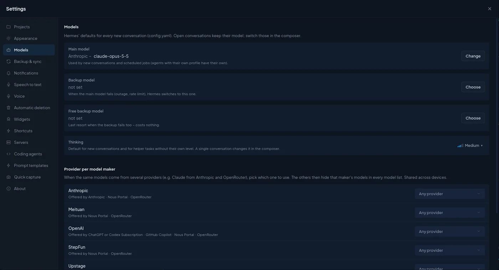
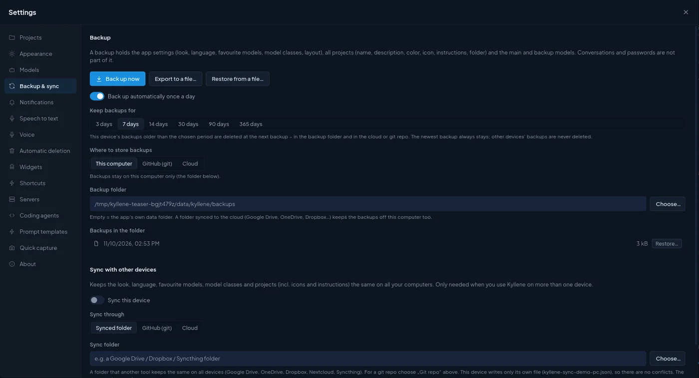
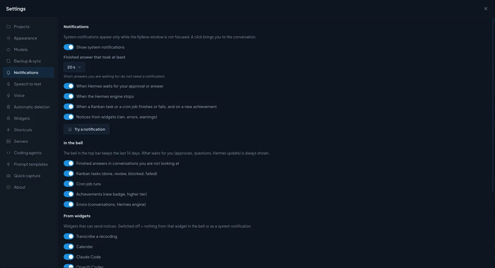

# Settings

Everything Kyllene itself remembers lives in **Settings**: open it with the gear icon in the top bar, with
`Ctrl+,`, or from the palette (`Ctrl+K` › *Settings*). The dialog has one tab per area on the left and remembers the
tab you used last.

Settings that belong to **Hermes** (skills, MCP servers, keys, cron jobs, Hermes' own config) are not here but in the
**Hermes** window: see [Manage Hermes in Kyllene](hermes.md).

Some choices are kept **only on this computer** (folders, devices, microphone), others **travel to your other
computers** when [sync](sync.md) is on. Each section below says which.

**Tabs:** [Projects](#projects) · [Appearance](#appearance) · [Pet](#pet) · [Models](#models) · [Backup & sync](#backup--sync) ·
[Notifications](#notifications) · [Speech to text](#speech-to-text) · [Voice](#voice) ·
[Automatic deletion](#automatic-deletion) · [Widgets](#widgets) · [Shortcuts](#shortcuts) · [Servers](#servers) ·
[Coding agents](#coding-agents) · [Prompt templates](#prompt-templates) · [Quick capture](#quick-capture) ·
[About](#about) · [Status bar](#the-status-bar)

## Projects

Where new projects go and how they are stored. More about projects: [Projects and tasklists](projects.md).

| Option | Default | What it does / when to change it |
|---|---|---|
| **Folder for new projects** | `~/KylleneProjects` | Each new project gets its own subfolder here. You can still pick another folder when you create a project. **Default** puts the suggested folder back. Only this computer. |
| **Storage** | *This computer* | Where **new** projects are stored: *This computer* (a plain folder), *GitHub (git)* (Kyllene commits and pushes after every agent answer that changed files) or *Cloud* (Google Drive, OneDrive or Dropbox). Each project can be switched later on its own *Storage* tab. |
| **GitHub owner** *(with GitHub)* | your signed-in account | Account or organisation that gets the new repos. Needs the GitHub CLI (`gh auth login`). **Move existing projects to GitHub…** gives each ticked project a private repo; folders stay where they are. |
| **Memory tool for „Remember“** | empty | Name of a Hermes tool with one text parameter (for example from a memory plugin). When set, messages outside projects get a **Remember** button that hands the message to this tool. In a project conversation, Remember always writes to the project memory. |
| **Memory tool label** | the tool name | The name shown on that button. |
| **Archived projects** | – | Projects you archived. **Restore** brings one back; its conversations come back with it. |

## Appearance

| Option | Default | What it does / when to change it |
|---|---|---|
| **Theme** | built-in look (*Navy*) | The list of looks. **New theme** starts the theme editor (from the current look or a preset; nothing is saved before *Create*). **Import…** loads a theme exported from Kyllene as `.json`. **Restore default look** switches back to the built-in look in both modes; your own themes stay. |
| **Open Activity in the thread** | *In panel* | Where a click on a turn's Activity row opens the list of tool calls: *In panel* = the Activity panel on the side, *In place* = unfolded right in the conversation. |
| **Open the agent's browser by itself** | on | The first time a turn works in a browser, the right panel switches to the agent's browser so you can watch. Off = open it yourself with the globe next to the turn's Activity row or from the palette. |

Light/dark mode, the colour scheme, the surface style and the **language** (English / Czech) sit in the
[status bar](#the-status-bar) at the bottom, so you can switch them without opening Settings.

## Pet

The animated pet that shows what the agent is doing. Hermes keeps **Show the pet**, the chosen pet and **Size**, so
the CLI and TUI show the same.

| Option | What it does |
|---|---|
| **Show the pet**, **Size** | Turn the pet on or off (also in the terminal) and set its size. |
| **Hatch a new one…** | AI draws a new pet from your description (paid image generation; the cost is shown first). |
| **Let the pet wander the window** | Off by default. The pet strolls along free spots while the agent is at rest. |
| **Your pets** | Your installed pets: **Show**, and **⋯** › **Rename**, **Personality…**, **Repair animations…** (hatched pets), **Generate moods…**, **Remove**. Under the shown pet: its current **Mood** and **Animation length** (1–8 s per animation, free). |
| **Pet brain** | **No memory** (default), **Memory**, **Agent** or **Combination**: how much the pet remembers and can do; with Memory its memory note, **What it knows about the user** (off by default) and **Skills**. |
| **Comments** | The speech bubble: **Mode** (**Off** / **Prepared lines**, default / **AI lines**), **Model of the lines**, **Longest silence** (default 5 min), **Language**, **Comment on my messages too** (off by default). |
| **Petdex** | The public gallery: search and **Adopt**. |

The shown pet, its size, personality, brain, memory, skills, own moods and animation lengths and **Let the pet wander
the window** travel to your other computers; whether the pet is shown, its spot on the screen and its mood stay on
this computer. Everything in detail: [Pet](pet.md) ([česky](pet.cs.md)).

## Models

Hermes' defaults for every **new** conversation. They are written to Hermes' `config.yaml`, so the Hermes terminal,
cron jobs and messaging bots use them too. A conversation that is already open keeps its model; switch it in the
composer.

| Option | Default | What it does / when to change it |
|---|---|---|
| **Main model** | what Hermes has (the first provider you connect sets it) | Used by new conversations and scheduled jobs. Agents with their own profile have their own main model. **Change** opens the model picker. |
| **Backup model** | not set | When the main model fails (outage, rate limit), Hermes switches to this one. Pick one from a different provider. |
| **Free backup model** | not set | The last resort when the backup fails too; pick a free model so it never costs anything. |
| **Thinking** | Hermes' default (*Medium*) | How hard the model thinks in every new conversation, and in helper tasks without their own level. One conversation can change it in the composer. |
| **Provider per model maker** | *Any provider* | When the same models come from several providers (Claude from Anthropic and from OpenRouter, for example), pick the one to use: the others then hide that maker's models in every model list. Saves you from picking the paid route by mistake. Shared across your devices. |
| **Model classes from benchmarks** | estimated | The picker sorts models into classes. Without a key the class is estimated from the model name and price; with a free [Artificial Analysis](https://artificialanalysis.ai) API key it comes from benchmarks. The key goes into Hermes' `.env`; Kyllene does not keep it. |

Providers themselves (sign-in, API keys) are connected in **Hermes › Models & providers**, see
[Manage Hermes](hermes.md#models--providers).

## Backup & sync

### Backup

A backup holds the app settings (look, language, favourite models, model classes, layout), all projects (name,
description, colour, icon, instructions, folder) and the main and backup models. **Conversations and passwords are
not part of it** (conversations are in Hermes' own database).

| Option | Default | What it does / when to change it |
|---|---|---|
| **Back up now / Export to a file… / Restore from a file…** | – | Manual backup, a backup file you keep yourself, and restore from such a file. |
| **Back up automatically once a day** | on | One backup per day. |
| **Keep backups for** | 7 days | This device's older backups are deleted at the next backup (in the folder and in the cloud or git repo). The newest backup always stays; other devices' backups are never deleted. |
| **Where to store backups** | *This computer* | *This computer* (the folder below), *GitHub (git)* or *Cloud*. |
| **Backup folder** | the app's data folder | Pick a folder that a cloud tool syncs (Google Drive, Dropbox…) to keep backups off this computer too. |
| **Backups in the folder** | – | Every backup with its date; **Restore…** returns to it. |

### Sync with other devices

Only needed when you use Kyllene on more than one computer. How it works and what travels: [Sync between
computers](sync.md).

| Option | Default | What it does / when to change it |
|---|---|---|
| **Sync this device** | off | Switch it on on every computer that should share settings, projects and widgets. |
| **Sync through** | *Synced folder* | *Synced folder* = a folder another tool keeps the same everywhere (Google Drive, OneDrive, Dropbox, Nextcloud, Syncthing); *GitHub (git)* = Kyllene keeps its own clone of a private repo and commits and pushes it; *Cloud* = a Google Drive, OneDrive or Dropbox account connected in Kyllene. |
| **Sync folder** / **Sync repo** | empty | The place itself. Each device writes only its own file (`kyllene-sync-<computer>.json`), so there are no conflicts; the newest change wins. |
| **Also store backups in the repo** *(git)* | off | Puts backups into the sync repo too (`backups/`, newest 7 per device). |

## Notifications

System notifications appear only while the Kyllene window is not focused; a click brings you to the conversation.

| Option | Default | What it does / when to change it |
|---|---|---|
| **Show system notifications** | on | The master switch for desktop notifications. |
| **Finished answer that took at least** | 20 s | Short answers you are waiting for anyway do not need a notification. Raise it if you get too many. |
| **When Hermes waits for your approval or answer** | on | A command to approve or a question with choices. Keep it on: a turn stands still until you answer. |
| **When the Hermes engine stops** | on | Hermes exited or crashed. |
| **When a Kanban task or a cron job finishes or fails, and on a new achievement** | on | Background work you did not start by hand. |
| **Notices from widgets** | on | Rain alerts, errors, warnings from widgets. |
| **Try a notification** | – | Sends a test, so you can check the desktop really shows them. |

**In the bell** (the bell in the top bar keeps the last 14 days; things that wait for you are always shown):
finished answers in conversations you are not looking at, Kanban tasks, cron job runs, achievements and errors, each
with its own switch (all on).

**From widgets**: one switch per widget that can send notices. Off = nothing from that widget, neither in the bell
nor as a desktop notification.

**Skill and memory changes in the thread**: when Hermes updates a skill or saves to its memory, Kyllene shows it as a
muted line in the conversation. How much Hermes' review after a turn reports is Hermes' own setting
`display.memory_notifications` (off / on / verbose); this section only shows its current value.

## Speech to text

Local transcription of recordings and dictation with **Whisper running inside Hermes**. The audio stays on this
computer. More: [Voice](voice.md).

- **System check** lists what transcription needs (Hermes' Python, Whisper, the model, disk space, memory, an NVIDIA
  card for speed, speaker detection). A missing part has **Fix** (Kyllene installs or downloads it) and **Fix with
  AI** (hands the problem to Hermes in a conversation).

| Option | Default | What it does / when to change it |
|---|---|---|
| **Local speech to text** | off | Turning it on installs what is missing and downloads the chosen model. |
| **Detect speakers** | on | Marks who is speaking in a transcript (Speaker 1, 2…), on this computer, no account. Installs `sherpa-onnx` and two small models (~90 MB). |
| **Model for recordings** | `large-v3` | *large-v3* (most accurate, ~2.9 GB, slow on a processor), *turbo* (almost as accurate, several times faster, ~1.5 GB), *medium* (~1.4 GB), *small* (~463 MB, a rough draft). Each shows an estimated time per hour of recording. Without an NVIDIA card, *turbo* is the usual choice. |
| **Language** | as in Hermes | The language spoken in recordings. A fixed language is more reliable than detection. |

## Voice

Dictation, reading answers aloud and the voice modes. Explained in [Voice](voice.md).

- The top shows a **read-only overview**: which dictation engine is used (*Automatic* = the local Whisper model,
  Hermes' speech recognition only when the local engine cannot run), which models and which reading voice Hermes has.
  The buttons lead to Hermes › Config, where Hermes' own voice settings live.

| Option | Default | What it does / when to change it |
|---|---|---|
| **Same model as for recordings transcription** | on | Dictation uses the recordings model. Turn it off to dictate with a smaller, faster model (on a processor *turbo* takes about half the time of *large-v3*). |
| **Dictation model** | – | Only downloaded models are offered. Only this computer. |
| **Microphone and speaker test** | – | **Say something** records five seconds and shows the transcript (never sent anywhere); **Play sample** plays Hermes' reading voice. |
| **Dictation shortcut** | `Ctrl+Space` | Hold to dictate, release to transcribe into the message. **Change** sets your own keys. |
| **Voice mode** | *Manual* | *Manual*: microphone button or shortcut, you send and read yourself. *Semi-automatic*: hold the shortcut, speak, release; Enter sends; finished answers are read aloud. *Automatic*: start listening once; a pause sends, the answer is read, then it listens again. The microphone is always off after a restart. |
| **Reading language** | the app language | The language answers are read in. It does not translate; Edge voices pick a matching voice. |
| **Speech volume threshold** | 0.025 | How loud sound must be to count as speech (Automatic mode). Raise it in a noisy room. |
| **Pause before sending (ms)** | 900 | How long a pause sends the message in Automatic mode. Raise it if you get cut off while thinking. |
| **Wake word on this computer** | off | Listens for Hermes' wake phrase with Hermes' local detector; the room audio stays on this computer and listening pauses while you dictate or Kyllene reads. Prepare the wake-word engine and model in Hermes first; Kyllene does not install them. When Hermes itself already listens (`/wake`), Kyllene does not take over. |

All voice choices are **saved only on this computer** (each computer has its own microphone).

## Automatic deletion

Two independent parts, each with its own switch and age. **Both are off by default**: nothing is deleted until you
switch a part on.

| Option | Default | What it does / when to change it |
|---|---|---|
| **Kanban archive › Delete old archived cards automatically** | off | Checked shortly after start and then daily, on every board. |
| **Time in the archive** | 30 days | A card is deleted once it has been archived longer than this (7 days … 6 months). |
| **Clean up now…** | – | Deletes, on every board, the cards archived longer than the limit, with comments, history and attachments. Shows the count first. Never deleted: cards an open card still waits for, and the sources of moved cards. |
| **Conversations › Delete old conversations automatically** | off | Checked a minute after start and then daily, on this computer, in every Hermes profile. Switching on first shows what would be deleted. |
| **No activity for longer than** | 3 months | 30 days … 6 months. |
| **Delete old conversations now / Preview…** | – | Shows the list first and asks; works with the switch off too. Never deleted: pinned conversations (in Hermes or in Kyllene's favourites), conversations open on this computer or with an unsent draft, running ones, conversations a Kanban card points to, and messaging, cron and Kanban worker conversations. |
| **Timeline between computers › Delete old synced timeline records** | on | Your computers exchange what ran on them through the sync folder, one file per month; older months are removed there. Hermes' own data is not touched. |
| **Keep for** | 6 months | 3 months, 6 months or a year. |

## Widgets

The widgets themselves (what they show, how to make your own) are explained in [Build your own widget](widgets.md).
This tab manages them.

- **AI services usage**: the built-in Claude Code, Codex and OpenRouter widgets with their version, state (*logged
  in*, *not connected*) and **Widget settings**. They read the logins on this computer; nothing private is synced.
- **System widgets** (Calendar, Mail, Google Tasks, GitLab, Teamwork, Weather): part of the app, they update with
  every new version. You switch them on in the **Widgets** menu and connect your own accounts in their settings.
  Their settings sync to your other computers.
- **Widgets**: your own widgets. With sync on they live in the sync folder (every device gets them), otherwise in
  the app's local folder (**Open folder**). A widget with unpublished changes has **Publish** (see
  [Publishing](widgets.md#publishing-a-widget)).

| Option | Default | What it does / when to change it |
|---|---|---|
| **Approve widget code from other devices** | on | New or changed widget code that arrives by sync runs here only after you approve it on this computer; changes made on this computer approve themselves. Turn it off only if you are the only one who can write to the sync place. |

**Custom achievements**: your own achievements as one `<id>.json` file each in the shown folder (synced when sync is
on). Files that cannot be used are listed with the reason.

## Shortcuts

Every keyboard shortcut of the app, grouped by where it works. Most are fixed; the dictation keys can be changed
here (**Change**), the [pet](pet.md#palette-commands-and-shortcuts) commands (choose, show / hide, its own window,
hatch) get a key of your own here (**Set**), widget shortcuts in the widget's ⋯ › *Widget settings*, the system-wide quick-capture keys in your
desktop's settings. The full list: [Keyboard shortcuts](shortcuts.md).

## Servers

Hermes on another machine (a VPS, a home server), reached **over SSH**. Conversations on a server are visible from
every computer that has it set up and work with that server's files and terminal. Only this computer.

| Field | What to enter |
|---|---|
| **Name** | Any name you will recognise in the menus. |
| **SSH host** | As for the `ssh` command: a host from `~/.ssh/config` or `user@192.0.2.5:22`. |
| **Hermes folder on the server** | Optional; only when Hermes is not in the usual place. |

**Add and test** checks the connection. Needs a key login without a password (`ssh <host>` must work without
prompting) and Hermes installed on the server. Kyllene uploads a small bridge to `~/.cache/kyllene` on the server
and runs it over SSH; nothing is exposed to the internet. Without a server, *New conversation on a server* stays
disabled.

## Coding agents

What each coding agent needs on this computer. More: [Coding agents](coding-agents.md).

- **Agents**: Claude Code and Codex, each with its state (*Ready* or what is missing): the command installed, the
  agent's own sign-in, the Hermes provider it runs on, and its current limits from the usage widgets.
  **Check again** after you install or sign in.
- **Folders with projects** (default `~/Projects` when it exists): a new Claude Code / Codex conversation offers the
  subfolders of these folders, next to your Kyllene projects and recently used folders. Add your code folders here.
  Only this computer.

## Prompt templates

Saved prompts you start with one click from the palette (`Ctrl+K`) or from an empty conversation.

- **New template**, then *Name*, *Description* (shown in the palette) and *Prompt*.
- Variables: `{{Name}}` is a field to fill in, `{{Name|default}}` a field with a default value. Before the start a
  short form asks for them; a repeated name is asked once.
- **Run** starts the template right away. The app ships three examples (Summary, Explain code, Write an e-mail);
  edit or delete them and your own list replaces them. Templates are the same on every device.

## Quick capture

A small window you open from anywhere, even with Kyllene in the background. Explained in [Quick
capture](quick-capture.md).

| Option | Default | What it does / when to change it |
|---|---|---|
| **Icon in the system tray** | on | Its menu opens the capture or takes a screenshot. On GNOME it needs the AppIndicator extension. |
| **System-wide shortcut** | off (suggested `Ctrl+Alt+Space`) | Works in every app. The desktop asks you once to confirm it; change the keys later in the system settings (*Apps › Kyllene › Global shortcuts*). |
| **Try it** | – | Opens the capture window now. |

## About

The Kyllene version, the Hermes versions this release was tested with (and the oldest one it supports) next to the
Hermes you have, and **Check for updates**. Kyllene checks by itself shortly after start and once a day; a new
version opens a window with *What's new* and **Update and restart**. A build from source code does not update itself.

## The status bar

The strip at the bottom of the window holds quick switches that are not in Settings:

| Part | What it does |
|---|---|
| connection | Whether Kyllene is connected to Hermes. |
| approvals | Command approvals: *manual* (asks about every risky command), *smart* (a helper model decides and asks when unsure) or *off*, for this conversation or for all (Hermes setting). |
| language | `EN` / `CS`: the app language. |
| surface, colours, light/dark | The surface style, the colour scheme and light or dark mode. |
| stop all | Stops every running answer at once. |

To hide parts you do not need, run **Edit layout** from the palette (`Ctrl+K`): the eye hides or shows a part, the
grip drags it elsewhere.
