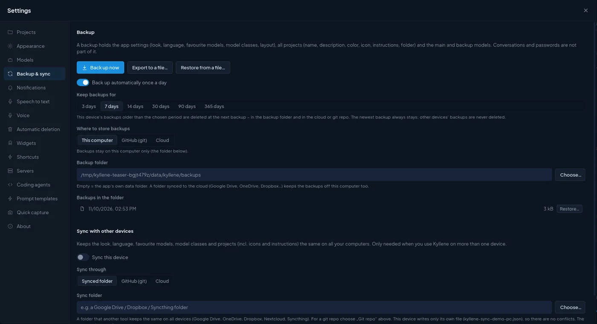

# Sync between computers

Use Kyllene on more than one computer (a desktop at work, a laptop at home) and keep it the same on all of them.
Nothing goes through a Kyllene server: sync uses a place **you** own, a synced folder, a private git repo or your
cloud drive.

## What travels and what does not

| Travels to your other computers | Stays on each computer |
|---|---|
| Look, language, favourite models, model classes | Conversations (in each computer's Hermes database) |
| Projects: name, description, colour, icon, instructions, folder, settings | Kanban boards and cards (also Hermes' database) |
| Widgets: your own widgets, their layout, settings and choices | Panel widths and which side panel is open |
| Prompt templates, cron job templates | Voice and microphone choices, dictation model |
| Which projects are deleted (a project deleted on one computer is deleted on the others) | Folders with code projects, servers |
| What ran on each computer (for the Timeline) | Hermes' own settings, keys and skills |

A project's **files** sync separately, through the project's own storage (*GitHub (git)* or *Cloud* on its
*Storage* tab, see [Projects](projects.md#the-project-window)). Hermes itself is not synced: install it on every
computer and connect the providers there.

## Set it up

1. On the first computer open [Settings › Backup & sync](settings.md#sync-with-other-devices) and switch on **Sync
   this device**.
2. Choose **Sync through**:
   - **Synced folder**: a folder that another tool keeps the same everywhere (Google Drive, OneDrive, Dropbox,
     Nextcloud, Syncthing).
   - **GitHub (git)**: a private repo. Kyllene keeps its own clone, commits and pushes; no other tool needed. Git
     uses your own credentials (SSH key, `gh`); Kyllene never stores a password.
   - **Cloud**: a Google Drive, OneDrive or Dropbox account connected in Kyllene.
3. On every other computer, install Kyllene and choose **the same** folder, repo or cloud account.

Each computer writes only its own file (`kyllene-sync-<computer>.json`), so two computers never overwrite each
other; for the same setting the newest change wins. **Sync now** syncs at once; *Devices* lists the computers and
when each last changed something.

## Widgets from other computers

Widget code that arrives from another computer runs only after you **approve** it on this one (Settings › Widgets ›
*Approve widget code from other devices*, on by default). Changes you make on this computer approve themselves. This
stops broken or unwanted code from spreading to all your computers.

## Backups are separate

Backups are not sync: they are snapshots you can go back to. They have their own place (*Where to store backups*)
and can also go into the sync repo. See [Settings › Backup](settings.md#backup).
